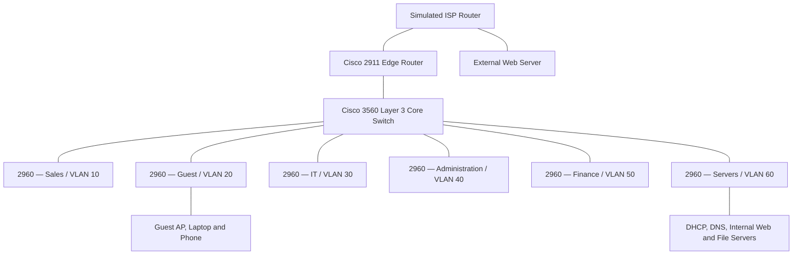

# NovaEdge Services Ltd — Secure Enterprise Network

**An enterprise network design and simulation in Cisco Packet Tracer.**

> **Project status: In progress — final validation.** The project owner reports that segmentation, routing, shared services, NAT/PAT, and several ACL controls have been implemented and tested. The SSH management test is **unresolved** (`Connection refused by remote host`). Final device exports, screenshots, and the original `.pkt` file have not yet been added to this repository scaffold.

## Overview

This project models a small enterprise network for **NovaEdge Services Ltd**, organized into six isolated departmental VLANs and connected through a Cisco Layer 3 core switch and a perimeter edge router. The simulation is designed to demonstrate IP planning, infrastructure configuration, policy enforcement, troubleshooting, and evidence-based verification.

**Address plan:** `192.168.10.0/24` divided using VLSM.

## Logical network topology



*This is a logical summary, not an exported Packet Tracer screenshot or a port-accurate topology. The authoritative visual should be added at `diagrams/network-topology.png` after export.*

## Network inventory

| Component | Model or type | Primary role |
|---|---|---|
| Core switch | Cisco Catalyst 3560 (Layer 3) | SVIs, inter-VLAN routing, DHCP relay |
| Access switches | Six Cisco 2960 switches | Departmental VLAN access and trunks |
| Enterprise edge router | Cisco 2911 | WAN connection, static routing, NAT/PAT, perimeter controls |
| Simulated ISP router | Cisco router in Packet Tracer | Upstream simulated network |
| External web server | Packet Tracer server | Simulated Internet test endpoint |
| Internal servers | DHCP, DNS, Web, File | Shared infrastructure services |
| End devices | Department PCs, guest Wi-Fi clients | Functional and security test endpoints |

## VLAN and IP addressing

| VLAN | Department | CIDR | Subnet mask | Default gateway |
|---|---|---|---|---|
| 10 | Sales | `192.168.10.0/26` | `255.255.255.192` | `192.168.10.1` |
| 20 | Guest | `192.168.10.64/27` | `255.255.255.224` | `192.168.10.65` |
| 30 | IT | `192.168.10.96/27` | `255.255.255.224` | `192.168.10.97` |
| 40 | Administration | `192.168.10.128/28` | `255.255.255.240` | `192.168.10.129` |
| 50 | Finance | `192.168.10.144/28` | `255.255.255.240` | `192.168.10.145` |
| 60 | Servers | `192.168.10.160/28` | `255.255.255.240` | `192.168.10.161` |

See [full IP addressing plan](docs/ip-addressing.md) for usable ranges, broadcasts, server allocations, and DHCP documentation fields.

## Technologies and reported progress

The following items were reported as implemented and tested in the Packet Tracer lab. **Exported validation evidence is still pending**, so these are not independently reproduced claims.

| Capability | Reported state | Evidence |
|---|---|---|
| VLSM design, VLANs, access/trunk ports | Implemented and tested | Pending capture |
| SVI-based inter-VLAN routing | Implemented and tested | Pending capture |
| Centralized DHCP and DHCP relay | Implemented and tested | Pending capture |
| DNS and internal web services | Implemented and tested | Pending capture |
| Static routing and NAT/PAT | Implemented and tested | Pending capture |
| Guest isolation | Implemented and tested | Pending capture |
| Sales-to-Finance restriction | Implemented and tested | Pending capture |
| Server outbound restrictions | Implemented and tested | Pending capture |
| Administration and Finance ACLs | Implemented and tested; exact rules to document | Pending capture |
| SSH management | **Failed — connection refused** | Retest pending |
| Final comprehensive regression test | **Pending** | Pending |

## Security objectives

- Separate departmental broadcast domains with VLANs and dedicated IP subnets.
- Limit guest access to internal enterprise resources while permitting intended external access.
- Prevent direct Sales-to-Finance access.
- Restrict server outbound traffic according to deployed ACLs.
- Apply documented Administration and Finance ACLs, with rule-level proof to be collected.
- Use secure device management (SSH) **once configured and verified**. SSH is currently **not a completed control**.

Read the [security policy](docs/security-policy.md) for the enforcement matrix, known facts, and evidence still required.

## Project structure

```text
NovaEdge-Secure-Enterprise-Network/
├── README.md
├── .gitignore
├── PROJECT_CHECKLIST.md
├── GITHUB_UPLOAD_GUIDE.md
├── docs/
│   ├── architecture.md
│   ├── ip-addressing.md
│   ├── security-policy.md
│   ├── validation-plan.md
│   └── troubleshooting.md
├── diagrams/
│   └── README.md
├── configs/
│   ├── README.md
│   └── access-switches/
├── evidence/
│   ├── screenshots/
│   │   └── README.md
│   └── test-results/
│       ├── README.md
│       └── validation-matrix.csv
└── packet-tracer/
    └── README.md
```

Directories reserved for outputs also contain `.gitkeep` files, omitted from the tree for readability.

## How to reproduce and review

1. Install **Cisco Packet Tracer** and obtain the authentic `.pkt` project file from `packet-tracer/` **once it is added**.
2. Open the project and compare the deployed topology with the [architecture documentation](docs/architecture.md).
3. Inspect real device configuration exports in `configs/` **once added**.
4. Run the checks in [validation-plan.md](docs/validation-plan.md) and compare results with `evidence/test-results/validation-matrix.csv`.
5. Review screenshots in `evidence/screenshots/` and the known SSH issue in [troubleshooting.md](docs/troubleshooting.md).

The repository scaffold alone does **not** contain a runnable network simulation.

## Current limitations / next work

- [ ] Diagnose the SSH refusal for the attempted connection to `192.168.10.97` and retest successfully.
- [ ] Export sanitized running configurations for real devices; document precise ACL entries and locations.
- [ ] Record each test outcome and gather supporting CLI / Packet Tracer screenshots.
- [ ] Export the authoritative topology image and place the real `.pkt` file in this repository.
- [ ] Run a final regression test and update this README with actual evidence links.
- [ ] Change project status from *In progress* to *Validated* **only after proof is present**.

## Documentation index

- [Architecture and data flows](docs/architecture.md)
- [IP addressing and subnet design](docs/ip-addressing.md)
- [Security policies](docs/security-policy.md)
- [Validation and evidence plan](docs/validation-plan.md)
- [Troubleshooting log](docs/troubleshooting.md)
- [Release checklist](PROJECT_CHECKLIST.md)
- [GitHub upload guide](GITHUB_UPLOAD_GUIDE.md)

**Project type:** simulated educational lab. **Organization name:** NovaEdge Services Ltd (fictional lab scenario). No actual production network is described.
